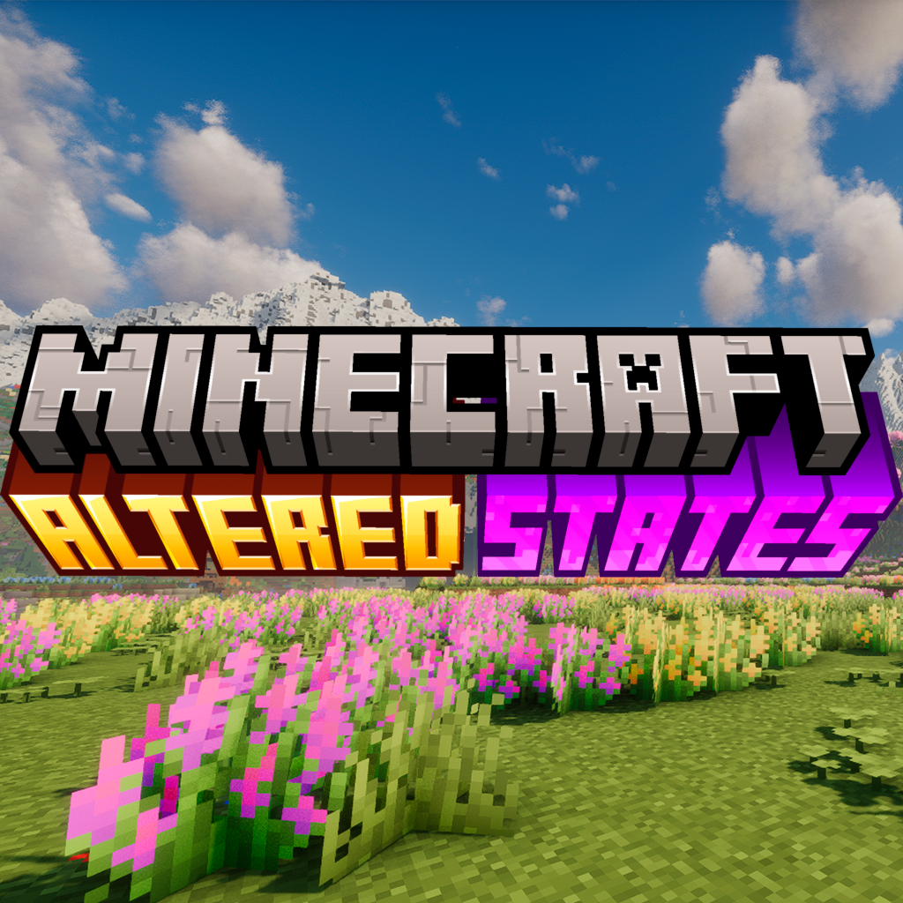

# Altered States

**Altered States** is an immersive Minecraft mod that introduces a wide range of drug-related content, adding new plants, consumables, and tools to enhance gameplay and roleplay experiences.

---

## 🌱 Features

### Tobacco
- Growable tobacco plants
- Cigarettes, cigars, and smoking pipes
- Loose tobacco and roll-your-own cigarettes

### Marijuana
- Growable cannabis plants with two distinct strains: **Indica** and **Sativa**
- Each strain has its own seeds, growth characteristics and effects
- Customizable joints that carry the effects of the strain they're rolled with

| Strain | Profile | Effects |
|--------|---------|---------|
| **Indica** | Relaxing | *(e.g. Slowness, Resistance, Regeneration)* |
| **Sativa** | Energizing | *(e.g. Speed, Haste, Jump Boost)* |

### Other Substances
- Hallucinogenic mushrooms

---

## 🛠 Compatibility
- Designed for version of Minecraft 1.21.1 NeoForge
- Works alongside most content mods

---

## 📦 Installation
1. Download the latest release from the [Releases](../../releases) page.
2. Place the `.jar` file into your `mods` folder.
3. Launch Minecraft with NeoForge.

---

## ⚠ Disclaimer
This mod is intended for **fictional gameplay purposes only**. It does not promote or encourage real-life drug use.

---

## 🤝 Contributing
Contributions, bug reports, and feature suggestions are welcome via the [Issues](../../issues) tab.

---

## 📜 License
- **Code:** [LGPL-3.0-or-later](COPYING.LESSER)
- **Assets** (textures, models, sounds): [CC BY 4.0](LICENSE-ASSETS.md)

Copyright (C) 2026 SuperJavidoor and aso38-ua.

By contributing, you agree that your contributions will be licensed under the same terms.

---
