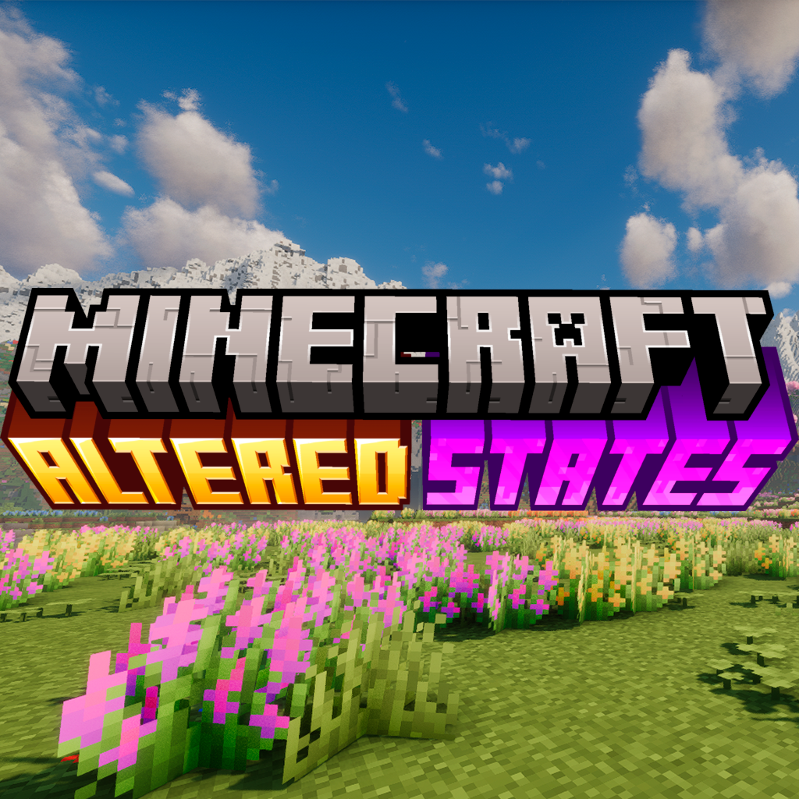

# Altered States

Altered States is an immersive Minecraft mod about fictional recreational substances. It adds new plants, machines, consumables and tools, along with a tolerance, dependency and withdrawal system, to enhance gameplay and roleplay experiences.

## 🌱 Features

### Tobacco
- Growable tobacco plants and wild patches
- Cigarettes, cigars and smoking pipes
- Loose tobacco and roll-your-own cigarettes

### Cannabis
- Two strains, Indica and Sativa, each with its own seeds, growth characteristics and effects
- Drying rack, curing jar, grinder, rolling tray and bong, all with block rotation
- Customizable joints that carry the effects and quality of the strain they're rolled with
- Edibles such as cannabutter and brownies

| Strain | Profile | Effects |
|---|---|---|
| Indica | Relaxing | e.g. Slowness, Resistance, Regeneration |
| Sativa | Energizing | e.g. Speed, Haste, Jump Boost |

### Mushrooms
- Mystic and Oniric mushrooms grown on prepared substrate, dried and ground for use

### Cocaine
- Coca plant with wild spawning and shear harvesting, plus seasonal and biome-dependent growth
- Production chain: Industrial Cauldron, Lab Furnace, Grinder and Cutting Mirror
- Gasoline as a fluid with its own bucket, plus support for other mods' fuel tags
- Effects scaled by quality, a crash that grows with your session, and overdose roulette

### Dependency system
- Tolerance, dependency and withdrawal per substance
- `/alteredstates status` shows your doses and state; admins can reset them

## 🛠 Compatibility
- Minecraft 1.21.1, NeoForge
- Serene Seasons and Ecliptic Seasons (seasonal crops, humidity)
- Create (Blaze Burner heat source), Farmer's Delight, JEI
- Works alongside most content mods

## 📦 Installation
1. Download the latest release from the Releases page.
2. Place the `.jar` file into your `mods` folder.
3. Launch Minecraft with NeoForge.

## 🗺 Roadmap
Vaping and teas, then the Opium update, followed by more substances.

## ⚠ Disclaimer
This mod is intended for fictional gameplay purposes only. It does not promote or encourage real-life drug use. All mechanics and recipes are invented for the game.

## 🤝 Contributing
Contributions, bug reports and feature suggestions are welcome via the Issues tab.

## 📜 License
Code: LGPL-3.0-or-later
Assets (textures, models, sounds): CC BY 4.0
Copyright (C) 2026 aso38-ua and SuperJavidoor.

By contributing, you agree that your contributions will be licensed under the same terms.
